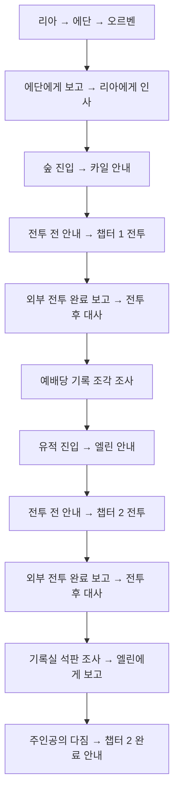

# 챕터 1·2 NPC와 대화 이벤트

플레이 범위는 전체 모험의 초반부인 **마을 → 숲 → 유적**이다. 챕터 1은 숲, 챕터 2는 유적이며 각 챕터에 몬스터 3종이 있다는 설정을 대사에 반영했다. 게임 전체의 엔딩·주인공 정체 공개·리아의 치료 완료·능력 해금은 이번 대화에 없다.

대화 그룹 27개, 대사 73줄, 조건 59개, 트리거 21개, 알림 14개를 사용한다. 원본은 `JsonConverter/ExcelFiles`의 대화 엑셀 5개이며 기존 컨버터로 `Assets/Resources/JsonOutput`을 갱신했다. 컨버터와 런타임 C#은 변경하지 않았다.

## 사용할 순서

1. 플레이 씬에 `Systems/DialogueEventSystem.prefab`을 하나 배치한다. 목표 알림과 챕터 2 완료 안내가 들어 있다. 이 묶음과 하위 UI 프리팹을 동시에 중복 배치하지 않는다.
2. 마을에 리아·에단·오르벤, 숲에 카일, 유적 입구에 엘린 프리팹을 배치한다.
3. 숲 입구에 `Area_EnterForest`, 유적 입구에 `Area_EnterRuins`를 배치하고 BoxCollider2D의 위치·크기를 통로에 맞춘다.
4. 각 전투 구역 입구에 `Event_Chapter1Combat`, `Event_Chapter2Combat`을 배치한다. `EntryArea`의 Collider를 구역 입구에 맞춘다.
5. 챕터 1 예배당에 `Object_ForestRelic`, 챕터 2 기록실에 `Object_RuinRecord`를 배치한다. 조건을 만족하면 표시된다.
6. 전투 담당 시스템의 시작·완료 이벤트를 아래 연결 방법대로 연결한다.

프리팹은 원점 기준으로 저장돼 있으며 기존 씬에는 배치하지 않았다. 맵마다 위치가 다르므로 씬에서 좌표를 정한다. 일반 NPC는 상호작용 거리 1.6 이내의 입력을 받으므로 서로 너무 가깝게 겹쳐 놓지 않는다.

씬에는 기존 GameManager, UIManager, PlayerStats와 PlayerInputHandler를 가진 플레이어, EventSystem이 필요하다. 현재 Manager 씬에는 EventSystem이 있으므로 새 UI 프리팹에는 중복 EventSystem을 넣지 않았다. 지역을 다른 씬으로 로드한다면 해당 씬의 기존 매니저 구성도 유지해야 한다.

## 필수 대화 흐름

전투 중간에 대사를 열거나 체력 비율을 확인하는 이벤트는 없다. 전투 시작 전 대사를 완료해야 시작 신호가 발생하고, 전투 완료가 보고된 뒤에만 전투 후 대사가 선택된다. “3종”은 몬스터 종류에 관한 설정이며 “3마리만 처치하면 완료”라는 판정은 넣지 않았다. 몬스터의 구체적인 이름·능력·스폰 구성과 전투 완료 판정은 전투 담당자가 정한다.

마을 재방문 보고와 반복 안내는 선택 대화다. 리아에게 치료제를 가져왔거나 치료가 끝났다는 대사는 없다. 챕터 2에서는 치료용 꽃의 기록과 다음 조사에 필요한 표식까지만 확보한다.

## 17개 프리팹

| 분류 | 프리팹 | 설정과 역할 |
| --- | --- | --- |
| Characters/Village | NPC_Ria | NpcInteraction: Story, NPC_RIA. 도입·출발 인사·선택 귀환 보고 |
| Characters/Village | NPC_Edan | NpcInteraction: Story, NPC_EDAN. 진료·오르벤 방문·출발 준비 |
| Characters/Village | NPC_Orben | NpcInteraction: Story, NPC_ORBEN. 치료 기록의 출처·숲길 안내 |
| Characters/Forest | NPC_Kyle | NpcInteraction: Story, NPC_KYLE. 숲의 위협과 예배당 안내 |
| Characters/Ruins | NPC_Elin | NpcInteraction: Story, NPC_ELIN. 유적 안내·기록 해독·챕터 2 보고 |
| Services | NPC_Shop | NpcInteraction: Shop, NPC_SHOP. 기존 ShopUI 사용 |
| Services | NPC_Artifact | NpcInteraction: Artifact, NPC_ARTIFACT. 기존 ArtifactUI 사용 |
| Events/Areas | Area_EnterForest | 조건 MS_COND_0016, 그룹 CH1_ENTRY. 리아에게 인사한 뒤 진입 가능 |
| Events/Areas | Area_EnterRuins | 조건 MS_COND_0034, 그룹 CH2_ENTRY. 숲 기록 조각을 조사한 뒤 진입 가능 |
| Events/Areas | Area_KyleIntro | 조건 MS_COND_0018, NPC_KYLE 자동 대화. 카일과 키로 상호작용하는 방식의 선택 대안 |
| Events/Combat | Event_Chapter1Combat | 전투 전 안내·시작 신호·외부 완료 보고를 받는 오브젝트 |
| Events/Combat | Event_Chapter2Combat | 같은 구조의 유적 전투 이벤트 |
| Events/Interactions | Object_ForestRelic | OBJECT_FOREST_RELIC, 조건 MS_COND_0027. 숲 전투 후 등장, 조사 뒤 숨김 |
| Events/Interactions | Object_RuinRecord | OBJECT_RUIN_RECORD, 조건 MS_COND_0045. 유적 전투 후 등장, 조사 뒤 숨김 |
| Events/Progression | Event_Chapter2Complete | TRG_MS_OUTRO 수신 → 챕터 2 완료 안내. “계속 둘러보기” 버튼 연결 |
| UI | MilestoneDialogueUI | DialogueNotificationUI의 패널·텍스트·4초 표시 설정 |
| Systems | DialogueEventSystem | 위 알림 UI와 완료 안내 프리팹을 묶은 배치용 프리팹 |

NPC에는 임시 실루엣·색상·한글 이름표·초상화가 연결돼 있다. `Actor/Visual`의 SpriteRenderer를 실제 외형으로 교체하면 된다. 이름표는 `Actor/NameLabel`, 초상화는 NpcInteraction의 `_portrait`에서 교체한다. NPC 대화 시작은 기존 PlayerInputHandler의 상호작용 입력을 사용하며, 자동 진입 대사가 필요한 카일 구역에는 Area_KyleIntro를 추가로 사용할 수 있다.

상점과 유물 NPC는 선택 기능이며 메인 스토리 진행 조건에 포함되지 않는다. 유물 장착 거절 음향의 `_feedbackSource`·`_equipRejectedClip`은 기존 선택 기능이라 비워 뒀다.

## 전투 담당 시스템과 연결

두 Combat 프리팹은 몬스터 스크립트를 직접 참조하지 않는다. 보스 체력 감시나 임의의 몬스터 프리팹·스폰 로직도 포함하지 않는다.

| 항목 | 챕터 1 | 챕터 2 |
| --- | --- | --- |
| 전투 전 대사 그룹 | CH1_COMBAT_INTRO | CH2_COMBAT_INTRO |
| 시작 트리거 | TRG_CH1_COMBAT_INTRO | TRG_CH2_COMBAT_INTRO |
| 시작 이벤트 기록 | MS_CH1_COMBAT_STARTED | MS_CH2_COMBAT_STARTED |
| 완료 보고 조건 | MS_COND_0056 | MS_COND_0058 |
| 완료 사건 | MS_CH1_COMBAT_CLEARED | MS_CH2_COMBAT_CLEARED |
| 전투 후 대사 그룹 | CH1_CLEAR | CH2_CLEAR |

**시작 연결:** Combat 프리팹 루트의 DialogueTriggerListener `_onTriggered`에는 EntryArea 비활성화가 이미 연결돼 있다. 이 UnityEvent에 전투 담당자가 제공하는 전투 시작 함수를 추가한다. 기존 연결은 유지한다. 전투는 진입 순간이 아니라 전투 전 대사가 끝나 시작 트리거가 발생했을 때 시작한다.

**완료 연결:** 전투 담당 시스템이 해당 구역의 전투 완료를 확정하면, 프리팹의 자식 `CombatCleared`에 붙은 **DialogueWorldTrigger.Activate()**를 호출한다. 이 컴포넌트에는 완료 조건·EventId·후속 그룹을 모두 설정해 두었다. 시작 전의 완료 호출과 완료 후 중복 호출은 조건에서 거부된다. Inspector의 UnityEvent에서 이 함수를 연결하거나, 담당 코드에서 해당 컴포넌트 참조로 호출할 수 있다.

이 외부 완료 알림을 연결하지 않으면 기록물이 나타나지 않아 다음 챕터로 진행할 수 없다. 현재 프로젝트에서 전투 완료를 제공하는 공통 API가 없으므로 연결 지점까지만 구성했다.

## 조건과 저장 설계

- 대화 순서는 CompletedDialogueGroup 조건으로 검사한다. 에단의 출발 안내는 MS_ORBEN_CLUE 완료가 필요하므로 오르벤을 건너뛸 수 없다.
- 두 기록물은 별도 활성 제어 오브젝트에 DialogueConditionGate를 두고 `Record` 자식만 켜고 끈다. 전투 후 대사를 마치면 나타나고 조사 완료 후 숨는다. 조건 체인 전체 검사와 Dynamic bool의 SetActive 연결을 설정했다.
- 전투 완료는 외부 Event 조건을 추가로 요구한다. 전투 전 대사를 마쳤다는 사실만으로 전투 후 대사가 열리지 않는다.
- 마지막 엘린 보고의 NextDialogueGroupId는 MS_OUTRO이며, 주인공의 다짐이 이어진 뒤 MS_PLAYABLE_COMPLETE를 기록한다.
- 그룹·조건·이벤트 ID를 이번 플레이 범위용으로 분리했다. 이전 저장의 RIA_00, ENDING_PROMPT 같은 완료 이력이나 높은 StoryStage가 새 대화를 건너뛰게 하지 않는다. 기존 사용자 저장 파일은 수정하지 않았다.
- 새 진행의 StoryStage는 숲 진입 1, 유적 진입 2, 이번 플레이 범위 완료 3을 기록한다. 기존 높은 StoryStage를 낮추지는 않으며, 새 대사의 진행 조건은 StoryStage에 의존하지 않는다.
- 실제 능력 해금은 이번 범위에 없다. 플레이어 이동·점프와 몬스터 동작을 수정하지 않았다.

장점은 전투 코드와 대화 진행을 분리하면서 엑셀 데이터로 선후 관계를 관리할 수 있다는 점이다. 단점은 씬 배치와 두 구역의 전투 시작·완료 연결이 필요하다는 점이다. 현재 단계의 도입과 지역 탐색에 집중하도록 후반 반전과 선택 분기를 남겨 두지 않았다.

## 수정된 파일

- JsonConverter/ExcelFiles/DialogueData.xlsx: 마을·숲·유적의 73줄로 재구성, 화자는 실제 표시 이름 사용
- JsonConverter/ExcelFiles/DialogueGroupData.xlsx: 필수·반복·선택 보고 27개 그룹
- JsonConverter/ExcelFiles/DialogueConditionData.xlsx: 완료 순서와 외부 전투 사건 조건 59개
- JsonConverter/ExcelFiles/DialogueTriggerData.xlsx: 플래그·진행 단계·이벤트·후속 대화 21개
- JsonConverter/ExcelFiles/DialogueNotificationData.xlsx: 지역 이동·조사 목표·챕터 완료 알림 14개
- Assets/Resources/JsonOutput의 같은 이름 JSON 5개: 기존 컨버터로 갱신
- Assets/Resources/UI/ContentUI/DialoaguetUI.prefab: 필요한 한글을 포함한 MilestoneNpcFont로 TMP 폰트·머티리얼 참조 설정

새 프리팹 17개와 실루엣·기록물 아이콘·폰트·머티리얼은 이 NPC 폴더에 있다. 게임용 C# 스크립트와 기존 씬은 변경하지 않았다.

## 확인한 사항

- 기존 컨버터가 생성한 JSON과 엑셀의 필드 값 일치 확인
- 대화·조건·트리거·알림·후속 그룹의 모든 참조 검사
- 프리팹 17개의 스크립트·데이터 ID·내부 참조·영구 이벤트 연결 검사
- 오르벤 방문 선행 조건, 지역 진입, 두 전투 완료 대기, 기록 조사, 엘린 보고와 자동 후속 대화 검사
- 실제 프리팹 인스턴스의 시작·완료 이벤트, 기록물 표시, 완료 안내 닫기, 저장 불러오기 동작 검사
- 임시 씬에서 NPC와 완료 안내 렌더링 확인. 검증은 별도 저장 경로를 사용했고 프로젝트의 사용자 저장과 기존 씬은 변경하지 않음

실제 맵에서 이동 경로·Collider 범위·몬스터 담당 시스템 연결은 배치 후 확인해야 한다. Collider2D 접촉 이벤트에는 양쪽 중 적어도 한쪽의 Rigidbody2D가 필요하며, 현재 Player 프리팹에는 Player 태그와 Rigidbody2D가 있다. 참고한 공식 문서: [Unity 6000.3 OnTriggerEnter2D](https://docs.unity.com/en-us/engine/6000.3/script-reference/unityengine/monobehaviour/ontriggerenter2d).
